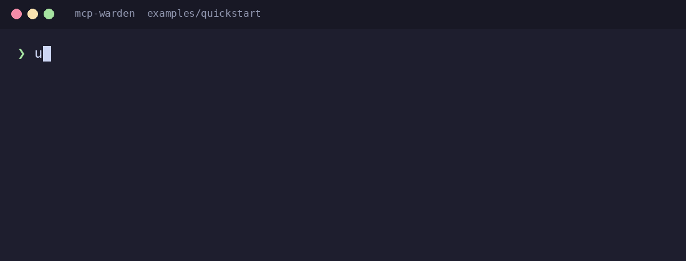
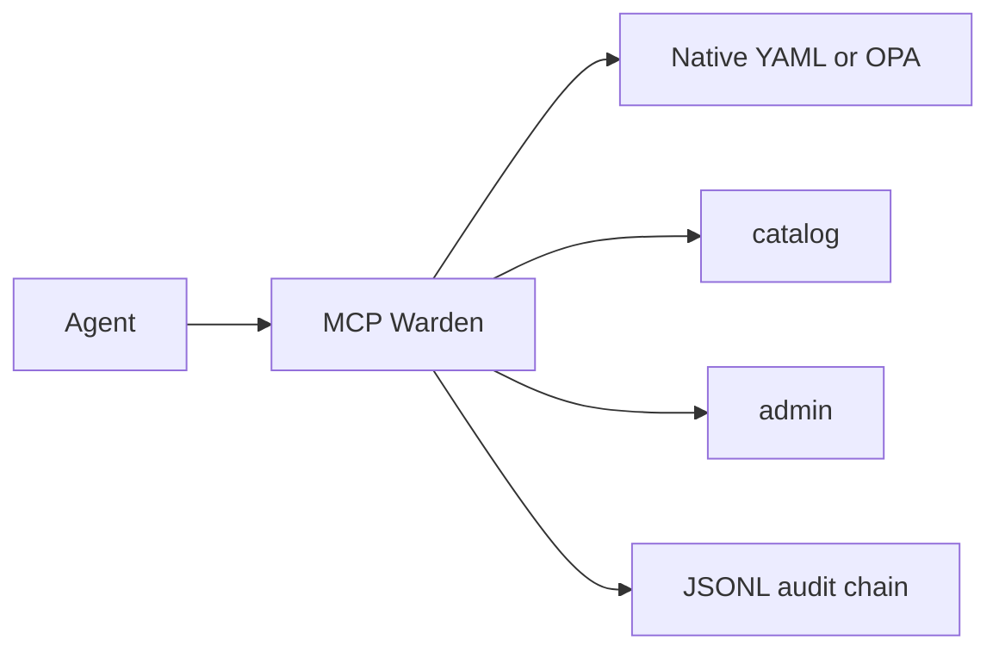

# MCP Warden — Policy-enforcing gateway between AI agents and MCP servers

[](.github/workflows/ci.yml)
[](LICENSE)

<!-- TODO: replace docs/demo.gif with a recording of analyst-agent, steward-agent, and a denied delete -->



## Why

Enterprises adopting MCP need the same controls they already have for APIs: least privilege per agent, data-classification-aware responses, and an audit trail. Putting those controls in each MCP server duplicates effort and the rules drift. MCP Warden is the gateway that centralises authentication, policy, obligations, and audit for the teams operating those agents.

## Quickstart

From a fresh checkout, with [uv](https://docs.astral.sh/uv/) installed:

```bash
uv run python -m examples.quickstart
```

That starts the catalog and admin fixture upstreams, applies `examples/policy.yaml`, and prints the analyst and steward outcomes. The bearer keys for the fixture principals are `analyst-secret`, `steward-secret`, and `rogue-secret`.

## How it works



An agent sends `tools/list` and `tools/call` to Warden. Warden authenticates the bearer key, asks the policy engine, drops hidden tools, and on an allow applies obligations in this order: redact fields, strip inferences, mask PII, then truncate. Names from upstream servers are published as `{server}__{tool}`.

Warden denies by default, including when authentication or policy evaluation fails. Destructive tools are blocked unless a rule allows them. API keys are stored and compared as SHA-256 hashes. The audit log keeps digests rather than raw arguments or responses. The chain is tamper-evident, not tamper-proof: every `audit.anchor_every` records (default 100) the latest hash is printed to stdout. The example config binds to localhost; terminate TLS at a reverse proxy.

## Results / example output

`uv run mcp-warden check-policy -c examples/warden.yaml` on the fixture upstreams:

```text
principal | tool | action | effect | rule_ids | reason
analyst-agent | catalog__get_column_profile | list | ALLOW | analysts-read-catalog | allow
analyst-agent | catalog__get_column_profile | call | ALLOW | analysts-read-catalog | allow
analyst-agent | catalog__search_assets | list | ALLOW | analysts-read-catalog | allow
analyst-agent | catalog__search_assets | call | ALLOW | analysts-read-catalog | allow
analyst-agent | admin__delete_asset | list | DENY | - | default deny
analyst-agent | admin__delete_asset | call | DENY | no-destructive | Destructive tools are blocked through the gateway.
analyst-agent | admin__list_jobs | list | DENY | - | default deny
analyst-agent | admin__list_jobs | call | DENY | - | default deny
steward-agent | catalog__get_column_profile | list | ALLOW | stewards-read-catalog | allow
steward-agent | catalog__get_column_profile | call | ALLOW | stewards-read-catalog | allow
steward-agent | catalog__search_assets | list | ALLOW | stewards-read-catalog | allow
steward-agent | catalog__search_assets | call | ALLOW | stewards-read-catalog | allow
steward-agent | admin__delete_asset | list | DENY | - | default deny
steward-agent | admin__delete_asset | call | DENY | no-destructive | Destructive tools are blocked through the gateway.
steward-agent | admin__list_jobs | list | DENY | - | default deny
steward-agent | admin__list_jobs | call | DENY | - | default deny
rogue-agent | catalog__get_column_profile | list | DENY | - | default deny
rogue-agent | catalog__get_column_profile | call | DENY | - | default deny
rogue-agent | catalog__search_assets | list | DENY | - | default deny
rogue-agent | catalog__search_assets | call | DENY | - | default deny
rogue-agent | admin__delete_asset | list | DENY | - | default deny
rogue-agent | admin__delete_asset | call | DENY | no-destructive | Destructive tools are blocked through the gateway.
rogue-agent | admin__list_jobs | list | DENY | - | default deny
rogue-agent | admin__list_jobs | call | DENY | - | default deny
```

After the quickstart, `uv run mcp-warden verify-log audit/warden.jsonl` prints:

```text
OK
```

## Design decisions

- [ADR 0001 — implementation base](docs/adr/0001-implementation-base.md)
- [ADR 0002 — audit writer](docs/adr/0002-audit-writer.md)
- [ADR 0003 — OPA engine](docs/adr/0003-opa-engine.md)

## Roadmap

- A human approval step for high-risk tools
- An anchor sink other than stdout
- Publishing the package

## Licence

Apache-2.0
