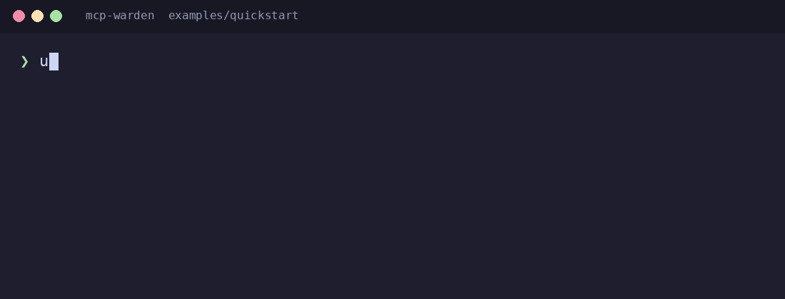
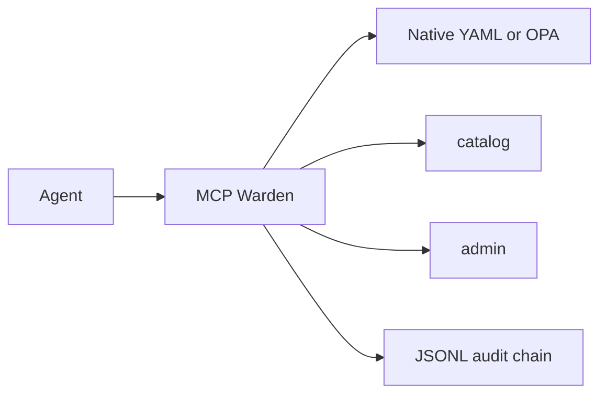

# MCP Warden — Policy-enforcing gateway between AI agents and MCP servers

[](.github/workflows/ci.yml)
[](LICENSE)



## Overview

MCP Warden sits between an AI agent and the MCP servers that agent can call. The agent connects only to Warden. Warden connects to the real upstream servers and republishes their tools as `{server}__{tool}`.

The problem is that a tool call is an action. An agent that can see every tool can read data it should not see, and it can take actions that are hard to undo, such as deleting an asset. Copying those checks into each MCP server duplicates the rules, and the copies drift. Warden is the one place that authenticates the agent, decides whether the tool is allowed, rewrites the response, and records the decision.

## Safety approach

Warden controls the tool channel. It does not try to supervise the model's reasoning. It refuses the call, or changes the payload, before the agent can use the result.

**Unauthorized use.** HTTP requests present a bearer key. Warden stores and compares SHA-256 digests, not the key. An unknown key receives HTTP 401 and is written to the application log as `authentication failed`, not into the audit chain. A known agent still starts from default deny: a tool is listed and callable only when a rule allows that principal, that server, and that tool. Denied tools are omitted from `tools/list`, so the agent is not offered them. A denied `tools/call` returns an error and is not forwarded. If policy evaluation throws, times out, or returns a malformed decision, the effect is DENY with reason `policy_engine_error`.

**Irreversible actions.** The shipped policy denies every call whose tool sets `destructiveHint: true`, for every principal. In the fixtures, `admin__delete_asset` matches the rule `no-destructive`. The gateway stops before the admin server runs. The upstream call log does not contain `delete_asset`, and the deny is still audited with that rule id.

**Allowed responses.** An allow can still carry obligations, applied in this order: redact named fields, strip AI inferences, mask email, phone, and card numbers, then truncate long arrays. The same column-profile call returns differently for two roles. The analyst receives `«email»`, an empty inference list, and `inference_permitted: false`. The steward receives `«email»` and still has the inference, because that role's rule only masks. An analyst search of 120 assets is cut to 50 and marked `_warden_truncated`.

**After the fact.** Every `tools/list` and `tools/call` appends one JSONL record through a single writer, so sequence numbers stay contiguous under concurrency. Arguments and responses are stored as SHA-256 digests. Each record includes the previous record's hash. `mcp-warden verify-log` recomputes the chain.

Rules can live in a YAML file or in OPA. The example Rego policy encodes the same allow and deny rows as the YAML file.

## Quickstart

From a fresh checkout, with [uv](https://docs.astral.sh/uv/) installed:

```bash
uv run python -m examples.quickstart
```

That starts the catalog and admin fixture upstreams, applies `examples/policy.yaml`, and prints the analyst and steward outcomes. The bearer keys for the fixture principals are `analyst-secret`, `steward-secret`, and `rogue-secret`.

## How it works



An agent sends `tools/list` and `tools/call` to Warden. Warden authenticates the bearer key, asks the policy engine, drops hidden tools, and on an allow applies the obligations above. The example config binds to localhost. Terminate TLS at a reverse proxy.

## Evidence

The demo above is the real quickstart: analyst profile value `«email»`, analyst inferences `0`, steward inferences `1`, and `delete_asset denied: true`.

`uv run mcp-warden check-policy -c examples/warden.yaml` printed this matrix on the fixture upstreams:

```text
principal | tool | action | effect | rule_ids | reason
analyst-agent | catalog__get_column_profile | list | ALLOW | analysts-read-catalog | allow
analyst-agent | catalog__get_column_profile | call | ALLOW | analysts-read-catalog | allow
analyst-agent | catalog__search_assets | list | ALLOW | analysts-read-catalog | allow
analyst-agent | catalog__search_assets | call | ALLOW | analysts-read-catalog | allow
analyst-agent | admin__delete_asset | list | DENY | - | default deny
analyst-agent | admin__delete_asset | call | DENY | no-destructive | Destructive tools are blocked through the gateway.
analyst-agent | admin__list_jobs | list | DENY | - | default deny
analyst-agent | admin__list_jobs | call | DENY | - | default deny
steward-agent | catalog__get_column_profile | list | ALLOW | stewards-read-catalog | allow
steward-agent | catalog__get_column_profile | call | ALLOW | stewards-read-catalog | allow
steward-agent | catalog__search_assets | list | ALLOW | stewards-read-catalog | allow
steward-agent | catalog__search_assets | call | ALLOW | stewards-read-catalog | allow
steward-agent | admin__delete_asset | list | DENY | - | default deny
steward-agent | admin__delete_asset | call | DENY | no-destructive | Destructive tools are blocked through the gateway.
steward-agent | admin__list_jobs | list | DENY | - | default deny
steward-agent | admin__list_jobs | call | DENY | - | default deny
rogue-agent | catalog__get_column_profile | list | DENY | - | default deny
rogue-agent | catalog__get_column_profile | call | DENY | - | default deny
rogue-agent | catalog__search_assets | list | DENY | - | default deny
rogue-agent | catalog__search_assets | call | DENY | - | default deny
rogue-agent | admin__delete_asset | list | DENY | - | default deny
rogue-agent | admin__delete_asset | call | DENY | no-destructive | Destructive tools are blocked through the gateway.
rogue-agent | admin__list_jobs | list | DENY | - | default deny
rogue-agent | admin__list_jobs | call | DENY | - | default deny
```

After that quickstart, `uv run mcp-warden verify-log audit/warden.jsonl` printed:

```text
OK
```

The test suite covers those rows end to end, each obligation on a crafted payload, a 100-call audit chain with contiguous sequence numbers, and OPA failures that must deny. CI runs lint, type-check, tests, and the quickstart on a fresh checkout. Design notes are in [ADR 0001](docs/adr/0001-implementation-base.md), [ADR 0002](docs/adr/0002-audit-writer.md), and [ADR 0003](docs/adr/0003-opa-engine.md). The full contract is [SPEC.md](SPEC.md).

## Limitations

- Warden only sees traffic that is sent through it. An agent with a direct connection to an upstream server bypasses every control.
- A destructive deny matches tools that advertise `destructiveHint: true`. A mutating tool that omits the hint is not classified as destructive. It is blocked only when no allow rule matches it.
- Rules do not inspect argument values. An allowed tool can be called with any arguments its schema accepts. There is no separate check that those arguments contain personal data.
- Masking covers email addresses, phone numbers, and Luhn-valid card numbers. Other personal data is left in place unless a field is named in a redact rule. Indian-identifier detection is used only when `bharat-pii-bench` is installed.
- Inference stripping recognises an epistemic envelope (`envelope_version` and `inference_permitted`) or objects labelled `epistemic_layer: inferred`. Other model-written text in arbitrary JSON is not removed.
- The audit log is tamper-evident, not tamper-proof. Someone who can rewrite the file can rebuild the hash chain. v0.1 anchors by printing the latest hash to stdout. There is no external anchor store, and there is no human approval step before a high-risk allow.
- v0.1 governs tools. Resources and prompts are hidden rather than proxied. There are no rate limits or quotas.

## Licence

Apache-2.0
