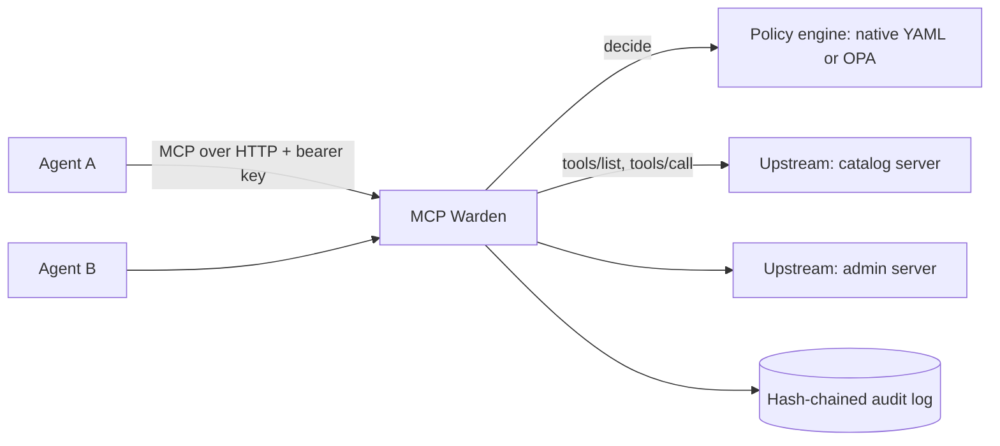

# MCP Warden — Policy-Enforcing Gateway for MCP

| | |
|---|---|
| Repo name | `mcp-warden` (package `mcp_warden`) |
| Version | 0.1.0 |
| Size | Medium |
| Depends on | optional: `epienv` (strip inferences), `bharat-pii-bench` detectors (PII masking) |

---

## 0. Using this spec with Cursor

Save as `SPEC.md` at the repo root. Implement one phase at a time from §11 with the prompts in Appendix A. Phase 1 starts with a spike that decides the implementation base (§3.2).

If this repository was created with the portfolio bootstrap, the prompts below are already filled in per phase in `CURSOR_PROMPTS.md`, and `.cursor/rules/project.mdc` already contains the project rules from Appendix A.

---

## 1. Purpose and scope

### 1.1 What it does

MCP Warden sits between AI agents and MCP servers. Agents connect to Warden as if it were one MCP server; Warden connects to the real (upstream) servers. On every request it authenticates the agent, asks a policy engine whether the action is allowed, applies obligations to the response (PII masking, withholding AI inferences, field redaction, truncation), and writes a tamper-evident audit record.

### 1.2 Why it matters

Enterprises adopting MCP need the same controls they have for APIs: least privilege per agent, data-classification-aware responses, and an audit trail. Putting those controls in each MCP server duplicates effort and drifts; a gateway centralises them.

### 1.3 Goals

1. Default deny: an agent sees and calls only tools a policy explicitly allows.
2. Destructive tools blocked unless a policy explicitly permits them.
3. Obligations applied to responses before they reach the agent.
4. Every decision auditable and verifiable after the fact.

### 1.4 Non-goals

Rate limiting and quotas, human approval workflows, argument-level PII egress checks, MCP resources and prompts (tools only in v0.1), multi-tenant deployment. All are candidate extensions.

---

## 2. Architecture



Upstream tools are exposed as `{server}__{tool}` (double underscore). Descriptions and schemas pass through unchanged, except that Warden may append a one-line governance note to descriptions when a principal's obligations include `strip_inferences`.

### 2.1 Request pipeline

**`tools/list`**
1. Authenticate → principal (or 401).
2. Fetch upstream tool lists (cached, TTL 60 s).
3. For each tool, `decide(action="list", …)`. Include only ALLOW.

**`tools/call`**
1. Authenticate → principal.
2. Resolve `{server}__{tool}`; unknown → error.
3. `decide(action="call", …)`. DENY → MCP error result with the reason and rule ID; audit; stop.
4. Validate arguments against the tool's `inputSchema` (`jsonschema`); invalid → error; audit; stop.
5. Forward to upstream with timeout.
6. Apply obligations to the response in fixed order: `redact_fields` → `strip_inferences` → `mask_pii` → `max_items`.
7. Audit; return.

Decision and obligation logic are pure functions independent of the MCP framework, so they can be tested without any server.

---

## 3. Technology stack and implementation base

### 3.1 Stack

| Concern | Choice |
|---|---|
| Language | Python 3.11+, `uv` |
| MCP | `fastmcp` 2.x (preferred base) or `mcp` low-level server (fallback) |
| Config | YAML → `pydantic` v2 |
| Policy | native YAML engine (default); OPA via REST (optional) |
| Validation | `jsonschema` |
| HTTP | `httpx` (OPA client) |
| Telemetry | optional OpenTelemetry |
| Quality | `pytest`, `pytest-asyncio`, `ruff`, `mypy --strict` |

### 3.2 Phase 1 spike

Confirm against the installed `fastmcp` version that the gateway can: (a) proxy multiple upstream servers under name prefixes, (b) read the incoming HTTP `Authorization` header per request inside middleware, (c) filter `tools/list` results per request, (d) replace `tools/call` results. Record results in `docs/adr/0001-implementation-base.md`. If any capability is missing, build on the `mcp` low-level `Server` with the streamable HTTP transport and implement proxying directly. Either way, the pure core (§4–§7) is unchanged.

---

## 4. Principals and authentication

`principals.yaml`:

```yaml
principals:
  - id: analyst-agent
    key_sha256: "<sha256 hex of the API key>"
    attributes: {roles: [analyst], team: finance, clearance: internal}
  - id: steward-agent
    key_sha256: "…"
    attributes: {roles: [steward], team: governance, clearance: confidential}
```

- Agents send `Authorization: Bearer <key>`. Warden hashes the key and looks up the principal with a constant-time comparison. Keys are never stored or logged in plaintext.
- `mcp-warden hash-key` prints the SHA-256 of a key read from stdin.
- In stdio mode (single local agent), the principal ID comes from the `WARDEN_PRINCIPAL` environment variable.

---

## 5. Policy

### 5.1 Decision model

```python
class DecisionRequest(Frozen):
    action: Literal["list", "call"]
    principal: Principal
    server: str
    tool: str
    annotations: dict[str, Any]           # upstream tool annotations ({} if absent)
    arguments: dict[str, Any] | None      # call only

class Decision(Frozen):
    effect: Literal["ALLOW", "DENY"]
    rule_ids: tuple[str, ...]
    reason: str
    obligations: tuple[Obligation, ...]

class PolicyEngine(Protocol):
    async def decide(self, req: DecisionRequest) -> Decision: ...
```

### 5.2 Native YAML engine (default)

```yaml
default: deny
rules:
  - id: no-destructive
    effect: deny
    actions: [call]
    tools: {annotations: {destructiveHint: true}}
    reason: Destructive tools are blocked through the gateway.

  - id: analysts-read-catalog
    effect: allow
    actions: [list, call]
    principals: {roles: [analyst]}
    tools: {servers: [catalog], annotations: {readOnlyHint: true}}
    obligations:
      - {type: mask_pii}
      - {type: strip_inferences}
      - {type: max_items, n: 50}

  - id: stewards-read-catalog
    effect: allow
    actions: [list, call]
    principals: {roles: [steward]}
    tools: {servers: [catalog], annotations: {readOnlyHint: true}}
    obligations:
      - {type: mask_pii}
```

Matching:
- `principals`: every listed attribute must intersect (lists) or equal (scalars) the principal's attributes. Omitted = any principal.
- `tools.servers` / `tools.names`: glob lists. `tools.annotations`: each key must equal the tool's annotation value. A tool with no annotations never matches an annotation condition, so unannotated tools are denied unless allowed by name.
- `actions`: list of `list` / `call`.

Combining: **deny overrides**. Any matching deny → DENY (rule IDs of matching denies). Else any matching allow → ALLOW with the union of all matching allows' obligations (deduplicated by type; for `max_items`, the smallest `n` wins). Else the default.

### 5.3 OPA engine (optional, Phase 5)

POSTs `{"input": DecisionRequest}` to `{opa_url}/v1/data/{package_path}`. The Rego policy returns `{"allow": bool, "rule_ids": [...], "reason": str, "obligations": [...]}`. Missing or malformed results, timeouts, or connection errors → DENY with reason `policy_engine_error` (fail closed). Ship `policies/example.rego` equivalent to the YAML example and a `docker-compose.yml` with an OPA sidecar.

---

## 6. Obligations

| Type | Parameters | Behaviour |
|---|---|---|
| `redact_fields` | `paths: [JSONPath]` | Replace matched values in `structuredContent` with `"«redacted»"`; re-render text content from the modified structure when the text block is JSON. |
| `strip_inferences` | — | If the response is a Level 2 epistemic envelope, apply `epienv.enforce()` with `permitted=false`. If Level 1, remove objects labelled `epistemic_layer: inferred`. Otherwise no-op, recorded as `not_applicable` in the audit. |
| `mask_pii` | `detectors` (optional) | Apply the `PiiDetector` to every string value in structured content and every text block, replacing matches with typed tokens (`«email»`, `«in_aadhaar»`, …). |
| `max_items` | `n` | Truncate every top-level array in structured content to `n` items and add `"_warden_truncated": true`. |

`PiiDetector` is a protocol: `find(text) -> list[Span]`. The default implementation covers email, phone, and card-like numbers; if `bharat-pii-bench` is installed, its regex+checksum detector is used, which adds Indian identifiers.

---

## 7. Audit log

JSON Lines. One record per `tools/call` request, and one per `tools/list` request (with `action: "list"`, `visible_tools` count and `hidden_tools` count instead of tool, argument, and response fields):

```json
{"seq": 42, "ts": "2026-09-30T10:15:02.123Z", "principal": "analyst-agent",
 "action": "call", "server": "catalog", "tool": "get_column_profile",
 "arguments_sha256": "…", "effect": "ALLOW", "rule_ids": ["analysts-read-catalog"],
 "obligations_applied": ["mask_pii", "strip_inferences"], "upstream_status": "ok",
 "latency_ms": 184, "response_sha256": "…",
 "prev_hash": "…64 hex…", "hash": "…64 hex…"}
```

- `hash = sha256(canonical_json(record without "hash"))`, where canonical JSON uses sorted keys, `(",", ":")` separators, and UTF-8. `prev_hash` is the previous record's hash; the first record uses 64 zeros.
- Arguments and responses are stored as digests only by default. `audit.store_masked_arguments: true` also stores PII-masked arguments.
- `mcp-warden verify-log FILE` recomputes the chain and reports the first broken `seq`, or OK.
- **Tamper-evident, not tamper-proof:** someone with write access can rewrite the entire chain. Mitigate by anchoring: every `audit.anchor_every` records (default 100), emit the latest hash to an external sink (stdout/syslog in v0.1; pluggable `AnchorSink`). Document this limitation in the README.
- Writes are serialised through a single async writer task so `seq` and `prev_hash` stay consistent under concurrency.

---

## 8. Configuration (`warden.yaml`)

```yaml
listen: {transport: streamable_http, host: 127.0.0.1, port: 8900, path: /mcp}
principals_file: ./principals.yaml
policy: {engine: native, file: ./policy.yaml}      # or {engine: opa, url: http://opa:8181, package: mcpwarden/decision}
upstreams:
  catalog: {transport: stdio, command: python, args: ["-m", "examples.catalog_server"]}
  admin:   {transport: streamable_http, url: http://localhost:9001/mcp, headers: {Authorization: "Bearer ${ADMIN_TOKEN}"}}
tools_cache_ttl_s: 60
upstream_timeout_s: 30
audit: {file: ./audit/warden.jsonl, anchor_every: 100, store_masked_arguments: false}
telemetry: {otel: false}
```

`${VAR}` interpolation from the environment; secrets never logged. CLI: `mcp-warden serve -c warden.yaml`, `mcp-warden verify-log FILE`, `mcp-warden hash-key`, `mcp-warden check-policy -c warden.yaml` (validates policy and prints the decision matrix for all principals × currently visible tools).

---

## 9. Testing

### 9.1 Fixture upstreams

- **catalog** (stdio): `get_column_profile` (readOnlyHint true; returns a Level 2 envelope containing an email address in a profiling value and one AI inference), `search_assets` (readOnlyHint true; returns 120 results).
- **admin** (stdio): `delete_asset` (destructiveHint true), `list_jobs` (no annotations).

Both append every received call to the file named by `FIXTURE_CALL_LOG`.

### 9.2 Decision matrix (golden)

Principals: `analyst-agent`, `steward-agent`, `rogue-agent` (no roles), plus an invalid key.

| Principal | Tool | Expected |
|---|---|---|
| analyst | catalog__get_column_profile | ALLOW; email masked; `ai_inferences` empty; `inference_permitted` false |
| steward | catalog__get_column_profile | ALLOW; email masked; inference present |
| analyst | catalog__search_assets | ALLOW; 50 items; `_warden_truncated` true |
| analyst | admin__delete_asset | DENY `no-destructive`; not in the analyst's tool list; never reaches upstream |
| steward | admin__delete_asset | DENY `no-destructive` |
| analyst | admin__list_jobs | DENY (default); not listed |
| rogue | any | DENY; tool list empty |
| invalid key | any | HTTP 401; audit records nothing |

Assertions: the upstream call log never contains `delete_asset` or `list_jobs`; every `tools/call` produces exactly one audit record and every `tools/list` exactly one; failed authentication is logged to the application log (not the audit chain); `verify-log` passes; editing any byte of any record makes `verify-log` report that record's `seq`.

### 9.3 Unit tests

Rule matching (each condition type), deny-overrides combining, obligation merging, each obligation on crafted payloads, canonical JSON stability, key hashing and constant-time lookup, OPA engine against a mocked HTTP server including fail-closed cases, concurrency test (100 parallel calls → contiguous `seq` and valid chain).

---

## 10. Security notes for the README

Default deny; destructive tools blocked by default; fail closed on policy errors; keys hashed; audit digests instead of payloads; tamper evidence with anchoring; bind to localhost by default; TLS termination expected at a reverse proxy.

---

## 11. Phases and acceptance criteria

**Phase 0 — Scaffold.** Config models, principals loader, `hash-key`, fixture upstreams. *Accept:* tooling passes; fixtures start over stdio. *Baseline:* the repository baseline in Appendix B.1 is in place, including a README stub with the project name, one-line value proposition, Why, and a planned Quickstart; the CI workflow's commands pass locally.

**Phase 1 — Spike and pass-through proxy.** ADR-0001; aggregated, namespaced pass-through with authentication (all tools allowed temporarily behind a test-only flag). *Accept:* an MCP client lists and calls namespaced fixture tools; an invalid key gets 401.

**Phase 2 — Native policy engine.** §5.1–5.2 and enforcement in the pipeline. *Accept:* every DENY/visibility row of §9.2 passes; `check-policy` prints the matrix.

**Phase 3 — Obligations.** §6. *Accept:* every ALLOW row of §9.2 passes, including masking, stripping, and truncation.

**Phase 4 — Audit log.** §7 and `verify-log`. *Accept:* audit assertions in §9.2 and the concurrency test pass.

**Phase 5 — OPA engine.** §5.3, example Rego, docker-compose. *Accept:* the §9.2 matrix passes with the OPA engine against the example policy; fail-closed tests pass.

**Phase 6 — Telemetry, docs, demo.** Optional OTel spans per decision; README with architecture diagram, security notes, and a demo GIF of an agent (e.g. Claude Desktop) connected through Warden. *Accept:* quickstart runs in one command with the fixture upstreams. *README:* README.md satisfies Appendix B.2 and B.3; a CI job runs the Quickstart on a fresh checkout and passes; all example output comes from real runs.

---

## 12. Conventions

Python 3.11+, `mypy --strict`, `ruff`. Decision and obligation code is pure and framework-independent. The gateway fails closed on any internal error during decision-making. No secrets or raw payloads in logs. No network in tests except local fixture servers and a mocked OPA.

---

## 13. Open decisions

1. **Implementation base** — resolved by the Phase 1 spike.
2. **Obligation order** — the fixed order in §2.1 step 6 masks PII after stripping inferences; confirm this is acceptable for all obligation combinations.
3. **Name availability** on GitHub and PyPI.
4. **Human approval workflow** for high-risk tools (e.g. a `require_approval` effect) — v0.2 candidate.

---

## Appendix A — Cursor prompts

<!-- bootstrap:phase-prompt -->
```
Read SPEC.md. Implement Phase N from §11 only. Satisfy every acceptance criterion for Phase N, write tests first where the spec gives expected outputs, and do not start later phases. If anything is ambiguous, list the ambiguity and stop.
```

<!-- bootstrap:review-prompt -->
```
Review the Phase N implementation against SPEC.md. For each acceptance criterion in §11, state whether it is met and which test proves it. List every divergence from the spec. Do not fix anything yet.
```

Project rules:

<!-- bootstrap:rules -->
```
- Default deny. Any error in authentication or policy evaluation results in DENY.
- Decision and obligation logic stay pure and framework-independent (src/mcp_warden/core/).
- Never log API keys, raw arguments, or raw responses.
- Every tools/list and tools/call request writes exactly one audit record through the single writer.
```

---

## Appendix B — Repository baseline and README

### B.1 Repository baseline (Phase 0)

- `README.md` stub (items 1, 4, and a planned Quickstart from B.2), `CHANGELOG.md` (Keep a Changelog format with an `[Unreleased]` section), `LICENSE` (Apache-2.0), `.gitignore`, and `docs/adr/` with a template. The portfolio bootstrap creates these; if the repository was created by hand, create them in Phase 0.
- `pyproject.toml` managed by `uv`, with `ruff` (lint and format) and `mypy --strict` configured there.
- `.pre-commit-config.yaml` running ruff, ruff-format, and basic hygiene hooks (trailing whitespace, end of file, YAML and JSON checks). Pin hook versions to the latest releases at Phase 0.
- `.github/workflows/ci.yml` running lint, type-check, and tests with `uv` on every push and pull request, plus the `web/` build and tests where the project has a UI. Add the CI badge to the README.
- Conventional commit messages, semantic versioning, and a CHANGELOG entry for every release.

### B.2 README requirements (Phase 6)

The README is a deliverable of Phase 6. Sections, in order:

1. `# <Name> — <one-line value proposition>`
2. Badges: CI, licence, PyPI (libraries only)
3. Demo: `` (placeholder until recorded; see B.3)
4. Why: 2–3 sentences on the problem and who has it
5. Quickstart: one command that works on a fresh machine
6. How it works: Mermaid architecture diagram and a short walkthrough
7. Results / example output: real output from the tool (see B.3)
8. Design decisions: links to `docs/adr/`
9. Roadmap: only things not yet built
10. Licence

Rules:

- Every command in the README must run. A CI job executes the Quickstart on a fresh checkout.
- All example output comes from a real run on the repository's fixtures, never written by hand.
- Keep it under about 150 lines; longer material goes in `docs/`.

### B.3 Demo and results for this project

- **Demo:** The same request from `analyst-agent` and `steward-agent` returns differently masked responses, and `admin__delete_asset` is denied.
- **Results / example output:** The decision matrix printed by `mcp-warden check-policy`, and a passing `mcp-warden verify-log` run.

The demo is recorded by a person, not generated. For terminal demos, Cursor may write a `docs/demo.tape` script for `vhs`, which records terminal sessions as GIFs; re-record whenever the output changes.

README prompt for Phase 6:

<!-- bootstrap:readme-prompt -->
```
Read SPEC.md, including Appendix B. Write README.md following Appendix B.2 exactly, with the demo and results content from B.3. Take the Quickstart commands from what actually works in this repository, and add a CI job that runs them on a fresh checkout. For "Results / example output", run the tool on the included fixtures and paste the real output; do not invent any output. Leave docs/demo.gif as a placeholder with a TODO. Keep it under 150 lines and move anything longer into docs/.
```
